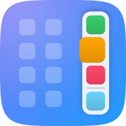

# SideDock

A vertical, floating Dock for jailbroken iPhones, with macOS-style magnification, recent apps, and a Dock you can pull in over any app.

## Features

- **Vertical floating Dock** on the right edge of the Home Screen, with a compact background. You can change its size and position.
- **macOS-style magnification**: icons grow as you slide a finger along the Dock.
- **Recent apps** appear below your pinned apps, after a divider. Show between 1 and 5.
- **Dock over apps**: swipe in from the right edge inside any app to switch apps.
- **Hide and show**:
  - Swipe the Dock away, or let it auto-hide after a delay.
  - A small handle on the edge brings it back.
- **Drag and drop** works into, out of and within the Dock.
- **Home Screen extras**:
  - Hide icon labels.
  - Use a denser grid, up to 6 × 8.
  - Set a custom icon corner radius, from square to circle. Folders, badges and widgets stay correct.
- Settings in **English** and **Vietnamese**.

## Compatibility

- iOS 17 and iOS 18
- rootless (Dopamine, palera1n) and roothide
- Tested on iPhone 15 Pro Max (iOS 17.3.1) and iOS 18.6.2

## Availability

Coming soon on [Havoc](https://havoc.app).

---

© 2026 koh. All rights reserved. This repository contains no source code.
